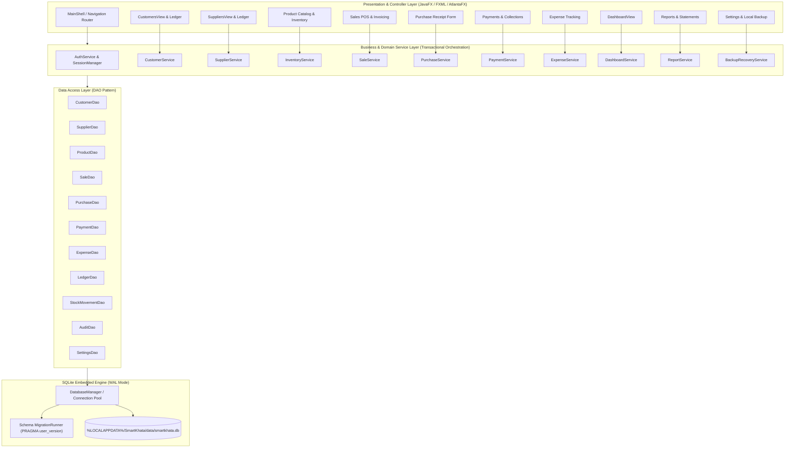

# SmartKhata — Desktop Architecture & Technical Specification

**Target Platform:** Windows 10 / 11 Desktop (Offline-First)  
**Technology Stack:** Java 21 LTS, JavaFX 21, AtlantaFX (Theme Engine), SQLite 3 via JDBC, Maven  
**Packaging:** `jpackage` / `jlink` native Windows application bundle (.msi / .exe)

---

## 1. System Overview & Offline-First Desktop Paradigm

SmartKhata is architected as a native, single-node, zero-network-dependency desktop application. Unlike web or hybrid Electron applications, SmartKhata boots directly on the Java Virtual Machine using high-performance JavaFX graphics pipelines (Direct3D on Windows), with persistent data managed by an embedded SQLite engine operating in Write-Ahead Logging (WAL) mode.



---

## 2. Layered Architecture & Package Responsibilities

The codebase enforces strict unidirectional dependency boundaries:
`ui / controller` $\rightarrow$ `service` $\rightarrow$ `dao` $\rightarrow$ `database`. Cross-cutting domain records and utilities (`model`, `util`) are shared across all layers.

### 2.1 Package Decomposition

```
com.smartkhata/
├── app/
│   ├── SmartKhataApp.java          # JavaFX Application bootstrap
│   ├── AppContext.java             # Lightweight DI container & service registry
│   ├── AppConfig.java              # Path resolver (%LOCALAPPDATA%), environment detection
│   └── ShutdownHook.java           # Safe WAL checkpoint and resource release
├── database/
│   ├── DatabaseManager.java        # Connection lifecycle, SQLite DataSource, PRAGMA setup
│   ├── TransactionManager.java     # Atomic transaction demarcation (executeInTransaction)
│   ├── MigrationRunner.java        # Sequential migration scripts (V1__init.sql, etc.)
│   └── SqliteDialect.java          # SQLite custom collation, datetime helpers
├── model/
│   ├── entity/                     # Business, User, Customer, Supplier, Product, Sale, etc.
│   ├── enums/                      # UserRole, PaymentMethod, MovementType, InvoiceStatus
│   ├── vo/                         # Value Objects: Money (Paisha), DateRange, AuditContext
│   └── dto/                        # DashboardKPIs, SalesTrendPoint, LedgerStatementRow
├── dao/
│   ├── api/                        # CustomerDao, SaleDao, LedgerDao interfaces
│   └── impl/                       # SqliteCustomerDao, SqliteSaleDao JDBC implementations
├── service/
│   ├── api/                        # SaleService, PaymentService, BackupService interfaces
│   └── impl/                       # Transactional service implementations
├── reporting/
│   ├── DaybookReportService.java   # Daily financial reconciliation calculation
│   ├── PdfReportGenerator.java     # Printable PDF voucher & statement generator
│   └── CsvExporter.java            # Standard RFC 4180 CSV exporter
├── ui/
│   ├── ViewRouter.java             # Navigation switcher, view caching, breadcrumbs
│   ├── ThemeManager.java           # AtlantaFX Primer Light / Dark theme controller
│   ├── components/                 # Reusable KPI card, StatusBadge, MoneyField, SearchBox
│   └── util/                       # AlertHelper, InputValidators, BengaliTextFormatter
└── controller/
    ├── MainShellController.java    # Sidebar navigation, top header, search shortcut hook
    ├── DashboardController.java    # KPI cards, trend line chart, recent list, quick actions
    ├── CustomerListController.java # Table, search, filter, open ledger
    ├── SaleFormController.java     # Fast POS invoicing, customer search, cart calculation
    └── ...                         # Dedicated controllers for each screen/dialog
```

### 2.2 Layer Isolation Rules
1. **Controllers never execute SQL:** Controllers only invoke Services. They remain lightweight, handling user events, input validation, and updating observable UI state.
2. **Services never reference JavaFX UI controls:** Services operate strictly on domain models and POJOs. Long-running operations (reporting, backups, batch imports) return `CompletableFuture` or run on background worker threads (`Executors.newVirtualThreadPerTaskExecutor()`).
3. **DAOs accept an open `Connection`:** When a service method requires transactional atomicity (e.g., Sale creation involving `sales`, `sale_items`, `stock_movements`, and `customer_ledger`), the `TransactionManager` passes the active `Connection` to each DAO method within a single transaction scope.
4. **Data Isolation:** All DAO queries scope records by `business_id` to guarantee tenant isolation and multi-store readiness.

---

## 3. Visual Layout, Navigation & Screen Inventory

### 3.1 Design Reference Mapping (`docs/dashboard-reference.png`)

Inspection of the approved visual reference confirms a modern, spacious desktop layout targeting **1600×900** resolution (with fluid responsiveness down to **1280×800**). The visual theme is built upon **AtlantaFX Primer Light** with customized accents:
- **Primary Color:** Deep Royal Blue (`#1E60D5` / `#0D6EFD`) for active navigation, primary action buttons, and sales charts.
- **Success / Collection Color:** Vibrant Emerald Green (`#16A34A` / `#22C55E`) for payments received and collection KPIs.
- **Warning / Due Color:** Warm Amber / Tangerine (`#EA580C` / `#F97316`) for Baki (due) alerts and low stock warnings.
- **Expense / Alert Color:** Coral Red (`#DC2626`) for operational expenses and out-of-stock notices.
- **Card Surfaces:** Pure white (`#FFFFFF`) rounded panels with subtle border strokes (`#E2E8F0`, 1px solid) and soft elevation drop-shadows.

```
+---------------------------------------------------------------------------------------------------+
| SmartKhata - Bookkeeping & Accounting                                      [_] [口] [X]           |
+---------------------------------------------------------------------------------------------------+
|  [Logo] SmartKhata    | [Q Search customers, invoices... Ctrl+K]  [Date Dropdown v] [Bell] [MS Owner v]   |
+-----------------------+---------------------------------------------------------------------------+
| [Dashboard]    (Active)| Business Dashboard                                                        |
| [Customers]           | Overview of today's activity                                              |
| [Suppliers]           | +---------------+ +---------------+ +---------------+ +---------------+  |
| [Sales]               | | Total Sales   | | Due Collection| | Expenses      | | Inventory Val |  |
| [Purchases]           | | BDT 4,86,530  | | BDT 1,92,750  | | BDT 1,36,420  | | BDT 8,74,230  |  |
| [Payments]            | +---------------+ +---------------+ +---------------+ +---------------+  |
| [Expenses]            | +-----------------------------------------+ +---------------------------+ |
| [Inventory]           | | Sales / Revenue Trend     [S] [C] [E]   | | Outstanding Dues (Baki)   | |
| [Reports]             | | [Interactive Line Chart]                | | BDT 3,27,600 (12 cust)    | |
| [Settings]            | | Total: BDT 4.86L  Avg: BDT 15.6K        | +---------------------------+ |
|                       | +-----------------------------------------+ | Low Stock Alerts (3 items)| |
|                       | +-----------------------------------------+ | - Sunflower Oil: 5 pcs    | |
|                       | | Recent Transactions            View All | +---------------------------+ |
|                       | | [Table: Date | Customer | Type | Amt ]  | +---------------------------+ |
|                       | | Jan 31  Rahman Trading  Sale  BDT 25.3K | | Quick Actions:            | |
|                       | | Jan 31  Karim Ent.   Payment  BDT 50.0K | | [Add Sale] [Receive Pay]  | |
|                       | | Jan 31  Bashundhara  Expense  BDT 12.5K | | [Add Exp]  [Add Customer] | |
|                       | +-----------------------------------------+ +---------------------------+ |
+-----------------------+---------------------------------------------------------------------------+
```

### 3.2 Screen & Dialog Inventory

| Screen / View ID | Type | Associated Module | Description & Key Controls |
| :--- | :--- | :--- | :--- |
| `VIEW_LOGIN` | Scene | Authentication | Local master password/PIN entry, business switcher, lock screen unlock |
| `VIEW_FIRST_RUN` | Dialog / Wizard | Onboarding | Business setup, owner credentials, initial settings, sample data toggle |
| `VIEW_MAIN_SHELL` | Shell Container | Navigation | Left collapsible sidebar, global search bar (`Ctrl+K`), header controls |
| `VIEW_DASHBOARD` | Main View | Dashboard | 4 KPI cards, sales trend chart, dues card, low stock alerts, quick actions |
| `VIEW_CUSTOMERS` | Main View | Customers | Searchable customer table, balances, filter active/archived, export |
| `VIEW_CUSTOMER_LEDGER`| Subview / Dialog | Customers | Chronological debit/credit statement, running balance, receipt print |
| `VIEW_SUPPLIERS` | Main View | Suppliers | Supplier table, payables, contact details, ledger shortcut |
| `VIEW_SUPPLIER_LEDGER`| Subview / Dialog | Suppliers | Purchase bills vs payment disbursements, outstanding payable balance |
| `VIEW_PRODUCTS` | Main View | Inventory | Product inventory table, SKU, category, stock count, cost/sell price |
| `VIEW_STOCK_LEDGER` | Dialog | Inventory | Stock movements audit trail (Receipts, Sales, Adjustments) per product |
| `VIEW_SALES_LIST` | Main View | Sales | All invoices, filter by status (Paid, Partial, Baki), date range |
| `VIEW_SALE_NEW` | Main View / Dialog | Sales POS | Customer autocomplete, item cart, barcode listener, discount, tender |
| `VIEW_PURCHASES_LIST` | Main View | Purchases | Purchase bills history, supplier name, status (Paid, Due) |
| `VIEW_PURCHASE_NEW` | Dialog | Purchases | Inward stock bill, supplier select, item lines, cost prices, paid amount |
| `VIEW_PAYMENTS` | Main View | Payments | Customer collections & supplier disbursements list |
| `VIEW_PAYMENT_COLLECT`| Dialog | Payments | Customer select, total due display, amount, payment method (MFS/Cash) |
| `VIEW_EXPENSES` | Main View | Expenses | Operational expenses list, category breakdown, add expense dialog |
| `VIEW_REPORTS` | Main View | Reporting | Daybook, Sales report, Due list, Profit & Loss estimate, CSV/PDF export |
| `VIEW_SETTINGS` | Main View | Settings | Business profile, tax/currency options, theme picker, language switcher |
| `VIEW_BACKUP_RESTORE`| Dialog / Tab | Maintenance | "Back Up Now", restore from `.skbak`, integrity verification |

---

## 4. Relational Data Model & SQLite DDL

The database is built on SQLite 3. SQLite features utilized include `PRAGMA foreign_keys = ON;`, `PRAGMA journal_mode = WAL;`, strict table constraints, and indexed lookups.

### 4.1 Schema DDL Specification

```sql
-- Database Initialization & Schema Versioning
PRAGMA foreign_keys = ON;
PRAGMA journal_mode = WAL;
PRAGMA busy_timeout = 5000;

-- 1. Business Profile
CREATE TABLE IF NOT EXISTS businesses (
    id INTEGER PRIMARY KEY AUTOINCREMENT,
    name TEXT NOT NULL,
    legal_name TEXT,
    phone TEXT,
    address TEXT,
    trade_license TEXT,
    currency_code TEXT NOT NULL DEFAULT 'BDT',
    created_at TEXT NOT NULL DEFAULT (datetime('now', 'localtime')),
    updated_at TEXT NOT NULL DEFAULT (datetime('now', 'localtime'))
);

-- 2. Local Users & Roles (Local Sign-In)
CREATE TABLE IF NOT EXISTS users (
    id INTEGER PRIMARY KEY AUTOINCREMENT,
    business_id INTEGER NOT NULL REFERENCES businesses(id) ON DELETE CASCADE,
    username TEXT NOT NULL UNIQUE,
    full_name TEXT NOT NULL,
    password_hash TEXT NOT NULL,
    salt TEXT NOT NULL,
    role TEXT NOT NULL CHECK (role IN ('OWNER', 'CASHIER')),
    is_active INTEGER NOT NULL DEFAULT 1 CHECK (is_active IN (0, 1)),
    last_login_at TEXT,
    created_at TEXT NOT NULL DEFAULT (datetime('now', 'localtime')),
    updated_at TEXT NOT NULL DEFAULT (datetime('now', 'localtime'))
);

-- 3. Customers (Parties)
CREATE TABLE IF NOT EXISTS customers (
    id INTEGER PRIMARY KEY AUTOINCREMENT,
    business_id INTEGER NOT NULL REFERENCES businesses(id) ON DELETE CASCADE,
    name TEXT NOT NULL,
    phone TEXT,
    address TEXT,
    credit_limit_paisha INTEGER NOT NULL DEFAULT 0,
    opening_balance_paisha INTEGER NOT NULL DEFAULT 0, -- positive = customer owes business
    is_archived INTEGER NOT NULL DEFAULT 0 CHECK (is_archived IN (0, 1)),
    notes TEXT,
    created_at TEXT NOT NULL DEFAULT (datetime('now', 'localtime')),
    updated_at TEXT NOT NULL DEFAULT (datetime('now', 'localtime'))
);
CREATE INDEX IF NOT EXISTS idx_customers_name_phone ON customers(business_id, name, phone);

-- 4. Suppliers (Vendors)
CREATE TABLE IF NOT EXISTS suppliers (
    id INTEGER PRIMARY KEY AUTOINCREMENT,
    business_id INTEGER NOT NULL REFERENCES businesses(id) ON DELETE CASCADE,
    name TEXT NOT NULL,
    contact_person TEXT,
    phone TEXT,
    address TEXT,
    opening_balance_paisha INTEGER NOT NULL DEFAULT 0, -- positive = business owes supplier
    is_archived INTEGER NOT NULL DEFAULT 0 CHECK (is_archived IN (0, 1)),
    notes TEXT,
    created_at TEXT NOT NULL DEFAULT (datetime('now', 'localtime')),
    updated_at TEXT NOT NULL DEFAULT (datetime('now', 'localtime'))
);
CREATE INDEX IF NOT EXISTS idx_suppliers_name ON suppliers(business_id, name);

-- 5. Product Categories
CREATE TABLE IF NOT EXISTS categories (
    id INTEGER PRIMARY KEY AUTOINCREMENT,
    business_id INTEGER NOT NULL REFERENCES businesses(id) ON DELETE CASCADE,
    name TEXT NOT NULL,
    description TEXT,
    created_at TEXT NOT NULL DEFAULT (datetime('now', 'localtime')),
    UNIQUE(business_id, name)
);

-- 6. Products Catalog
CREATE TABLE IF NOT EXISTS products (
    id INTEGER PRIMARY KEY AUTOINCREMENT,
    business_id INTEGER NOT NULL REFERENCES businesses(id) ON DELETE CASCADE,
    category_id INTEGER REFERENCES categories(id) ON DELETE SET NULL,
    name TEXT NOT NULL,
    barcode TEXT,
    sku TEXT,
    unit TEXT NOT NULL DEFAULT 'pcs', -- pcs, kg, litre, box, pkt
    cost_price_paisha INTEGER NOT NULL DEFAULT 0 CHECK (cost_price_paisha >= 0),
    selling_price_paisha INTEGER NOT NULL DEFAULT 0 CHECK (selling_price_paisha >= 0),
    low_stock_threshold INTEGER NOT NULL DEFAULT 5 CHECK (low_stock_threshold >= 0),
    is_archived INTEGER NOT NULL DEFAULT 0 CHECK (is_archived IN (0, 1)),
    created_at TEXT NOT NULL DEFAULT (datetime('now', 'localtime')),
    updated_at TEXT NOT NULL DEFAULT (datetime('now', 'localtime'))
);
CREATE INDEX IF NOT EXISTS idx_products_barcode ON products(business_id, barcode);
CREATE INDEX IF NOT EXISTS idx_products_name ON products(business_id, name);

-- 7. Stock Movements (Immutable Inventory Ledger)
CREATE TABLE IF NOT EXISTS stock_movements (
    id INTEGER PRIMARY KEY AUTOINCREMENT,
    business_id INTEGER NOT NULL REFERENCES businesses(id) ON DELETE CASCADE,
    product_id INTEGER NOT NULL REFERENCES products(id) ON DELETE RESTRICT,
    movement_type TEXT NOT NULL CHECK (movement_type IN ('OPENING', 'PURCHASE_IN', 'SALE_OUT', 'MANUAL_ADJUSTMENT', 'RETURN_IN', 'RETURN_OUT')),
    quantity INTEGER NOT NULL, -- positive for inward, negative for outward
    unit_cost_paisha INTEGER NOT NULL DEFAULT 0,
    reference_type TEXT CHECK (reference_type IN ('SALE', 'PURCHASE', 'MANUAL', 'RETURN')),
    reference_id INTEGER,
    notes TEXT,
    created_by_user_id INTEGER REFERENCES users(id),
    created_at TEXT NOT NULL DEFAULT (datetime('now', 'localtime'))
);
CREATE INDEX IF NOT EXISTS idx_stock_product_date ON stock_movements(product_id, created_at);

-- 8. Sales Invoices
CREATE TABLE IF NOT EXISTS sales (
    id INTEGER PRIMARY KEY AUTOINCREMENT,
    business_id INTEGER NOT NULL REFERENCES businesses(id) ON DELETE CASCADE,
    invoice_number TEXT NOT NULL UNIQUE,
    customer_id INTEGER REFERENCES customers(id) ON DELETE RESTRICT, -- NULL = Walk-in Cash Customer
    total_amount_paisha INTEGER NOT NULL CHECK (total_amount_paisha >= 0),
    discount_paisha INTEGER NOT NULL DEFAULT 0 CHECK (discount_paisha >= 0),
    net_amount_paisha INTEGER NOT NULL CHECK (net_amount_paisha >= 0),
    paid_amount_paisha INTEGER NOT NULL DEFAULT 0 CHECK (paid_amount_paisha >= 0),
    due_amount_paisha INTEGER NOT NULL DEFAULT 0 CHECK (due_amount_paisha >= 0),
    payment_status TEXT NOT NULL CHECK (payment_status IN ('PAID', 'PARTIAL', 'BAKI')),
    idempotency_key TEXT UNIQUE,
    invoice_date TEXT NOT NULL DEFAULT (datetime('now', 'localtime')),
    notes TEXT,
    created_by_user_id INTEGER NOT NULL REFERENCES users(id),
    is_reversed INTEGER NOT NULL DEFAULT 0 CHECK (is_reversed IN (0, 1)),
    reversal_reason TEXT,
    reversed_at TEXT,
    created_at TEXT NOT NULL DEFAULT (datetime('now', 'localtime')),
    updated_at TEXT NOT NULL DEFAULT (datetime('now', 'localtime'))
);
CREATE INDEX IF NOT EXISTS idx_sales_date ON sales(business_id, invoice_date);
CREATE INDEX IF NOT EXISTS idx_sales_customer ON sales(customer_id, payment_status);

-- 9. Sale Line Items
CREATE TABLE IF NOT EXISTS sale_items (
    id INTEGER PRIMARY KEY AUTOINCREMENT,
    sale_id INTEGER NOT NULL REFERENCES sales(id) ON DELETE CASCADE,
    product_id INTEGER NOT NULL REFERENCES products(id) ON DELETE RESTRICT,
    quantity INTEGER NOT NULL CHECK (quantity > 0),
    unit_price_paisha INTEGER NOT NULL CHECK (unit_price_paisha >= 0),
    unit_cost_paisha INTEGER NOT NULL DEFAULT 0,
    discount_paisha INTEGER NOT NULL DEFAULT 0,
    line_total_paisha INTEGER NOT NULL CHECK (line_total_paisha >= 0)
);

-- 10. Purchases (Supplier Invoices)
CREATE TABLE IF NOT EXISTS purchases (
    id INTEGER PRIMARY KEY AUTOINCREMENT,
    business_id INTEGER NOT NULL REFERENCES businesses(id) ON DELETE CASCADE,
    purchase_number TEXT NOT NULL UNIQUE,
    supplier_id INTEGER NOT NULL REFERENCES suppliers(id) ON DELETE RESTRICT,
    total_amount_paisha INTEGER NOT NULL CHECK (total_amount_paisha >= 0),
    discount_paisha INTEGER NOT NULL DEFAULT 0 CHECK (discount_paisha >= 0),
    net_amount_paisha INTEGER NOT NULL CHECK (net_amount_paisha >= 0),
    paid_amount_paisha INTEGER NOT NULL DEFAULT 0 CHECK (paid_amount_paisha >= 0),
    due_amount_paisha INTEGER NOT NULL DEFAULT 0 CHECK (due_amount_paisha >= 0),
    payment_status TEXT NOT NULL CHECK (payment_status IN ('PAID', 'PARTIAL', 'DUE')),
    purchase_date TEXT NOT NULL DEFAULT (datetime('now', 'localtime')),
    notes TEXT,
    created_by_user_id INTEGER NOT NULL REFERENCES users(id),
    is_reversed INTEGER NOT NULL DEFAULT 0 CHECK (is_reversed IN (0, 1)),
    created_at TEXT NOT NULL DEFAULT (datetime('now', 'localtime')),
    updated_at TEXT NOT NULL DEFAULT (datetime('now', 'localtime'))
);
CREATE INDEX IF NOT EXISTS idx_purchases_supplier ON purchases(supplier_id);

-- 11. Purchase Line Items
CREATE TABLE IF NOT EXISTS purchase_items (
    id INTEGER PRIMARY KEY AUTOINCREMENT,
    purchase_id INTEGER NOT NULL REFERENCES purchases(id) ON DELETE CASCADE,
    product_id INTEGER NOT NULL REFERENCES products(id) ON DELETE RESTRICT,
    quantity INTEGER NOT NULL CHECK (quantity > 0),
    unit_cost_paisha INTEGER NOT NULL CHECK (unit_cost_paisha >= 0),
    line_total_paisha INTEGER NOT NULL CHECK (line_total_paisha >= 0)
);

-- 12. Payments & Collections
CREATE TABLE IF NOT EXISTS payments (
    id INTEGER PRIMARY KEY AUTOINCREMENT,
    business_id INTEGER NOT NULL REFERENCES businesses(id) ON DELETE CASCADE,
    payment_number TEXT NOT NULL UNIQUE,
    party_type TEXT NOT NULL CHECK (party_type IN ('CUSTOMER', 'SUPPLIER')),
    party_id INTEGER NOT NULL,
    amount_paisha INTEGER NOT NULL CHECK (amount_paisha > 0),
    payment_date TEXT NOT NULL DEFAULT (datetime('now', 'localtime')),
    payment_method TEXT NOT NULL CHECK (payment_method IN ('CASH', 'BANK', 'BKASH', 'NAGAD', 'ROCKET', 'OTHER')),
    reference_trx_id TEXT,
    notes TEXT,
    created_by_user_id INTEGER NOT NULL REFERENCES users(id),
    idempotency_key TEXT UNIQUE,
    created_at TEXT NOT NULL DEFAULT (datetime('now', 'localtime'))
);

-- 13. Payment Allocations (Linking Payments to Specific Invoices / Purchases)
CREATE TABLE IF NOT EXISTS payment_allocations (
    id INTEGER PRIMARY KEY AUTOINCREMENT,
    payment_id INTEGER NOT NULL REFERENCES payments(id) ON DELETE CASCADE,
    sale_id INTEGER REFERENCES sales(id) ON DELETE SET NULL,
    purchase_id INTEGER REFERENCES purchases(id) ON DELETE SET NULL,
    allocated_amount_paisha INTEGER NOT NULL CHECK (allocated_amount_paisha > 0),
    created_at TEXT NOT NULL DEFAULT (datetime('now', 'localtime'))
);

-- 14. Customer Ledger (Double-Entry Debit/Credit Log for Receivables)
CREATE TABLE IF NOT EXISTS customer_ledger (
    id INTEGER PRIMARY KEY AUTOINCREMENT,
    business_id INTEGER NOT NULL REFERENCES businesses(id) ON DELETE CASCADE,
    customer_id INTEGER NOT NULL REFERENCES customers(id) ON DELETE CASCADE,
    entry_date TEXT NOT NULL DEFAULT (datetime('now', 'localtime')),
    entry_type TEXT NOT NULL CHECK (entry_type IN ('OPENING_BALANCE', 'SALE_INVOICE', 'PAYMENT_COLLECTION', 'INVOICE_REVERSAL', 'ADJUSTMENT')),
    reference_id INTEGER,
    debit_paisha INTEGER NOT NULL DEFAULT 0,  -- increases customer debt
    credit_paisha INTEGER NOT NULL DEFAULT 0, -- decreases customer debt
    running_balance_paisha INTEGER NOT NULL,
    notes TEXT,
    created_at TEXT NOT NULL DEFAULT (datetime('now', 'localtime'))
);
CREATE INDEX IF NOT EXISTS idx_cust_ledger_customer ON customer_ledger(customer_id, entry_date);

-- 15. Supplier Ledger (Double-Entry Debit/Credit Log for Payables)
CREATE TABLE IF NOT EXISTS supplier_ledger (
    id INTEGER PRIMARY KEY AUTOINCREMENT,
    business_id INTEGER NOT NULL REFERENCES businesses(id) ON DELETE CASCADE,
    supplier_id INTEGER NOT NULL REFERENCES suppliers(id) ON DELETE CASCADE,
    entry_date TEXT NOT NULL DEFAULT (datetime('now', 'localtime')),
    entry_type TEXT NOT NULL CHECK (entry_type IN ('OPENING_BALANCE', 'PURCHASE_BILL', 'PAYMENT_DISBURSEMENT', 'BILL_REVERSAL', 'ADJUSTMENT')),
    reference_id INTEGER,
    credit_paisha INTEGER NOT NULL DEFAULT 0, -- increases supplier payable
    debit_paisha INTEGER NOT NULL DEFAULT 0,  -- decreases supplier payable
    running_balance_paisha INTEGER NOT NULL,
    notes TEXT,
    created_at TEXT NOT NULL DEFAULT (datetime('now', 'localtime'))
);
CREATE INDEX IF NOT EXISTS idx_supp_ledger_supplier ON supplier_ledger(supplier_id, entry_date);

-- 16. Operational Expenses
CREATE TABLE IF NOT EXISTS expenses (
    id INTEGER PRIMARY KEY AUTOINCREMENT,
    business_id INTEGER NOT NULL REFERENCES businesses(id) ON DELETE CASCADE,
    category TEXT NOT NULL CHECK (category IN ('RENT', 'UTILITIES', 'SALARY', 'TRANSPORT', 'ENTERTAINMENT', 'MAINTENANCE', 'OTHER')),
    amount_paisha INTEGER NOT NULL CHECK (amount_paisha > 0),
    expense_date TEXT NOT NULL DEFAULT (datetime('now', 'localtime')),
    payment_method TEXT NOT NULL CHECK (payment_method IN ('CASH', 'BANK', 'BKASH', 'NAGAD', 'ROCKET', 'OTHER')),
    payee_name TEXT,
    notes TEXT,
    created_by_user_id INTEGER NOT NULL REFERENCES users(id),
    created_at TEXT NOT NULL DEFAULT (datetime('now', 'localtime'))
);
CREATE INDEX IF NOT EXISTS idx_expenses_date ON expenses(business_id, expense_date);

-- 17. Other Business Income
CREATE TABLE IF NOT EXISTS other_incomes (
    id INTEGER PRIMARY KEY AUTOINCREMENT,
    business_id INTEGER NOT NULL REFERENCES businesses(id) ON DELETE CASCADE,
    source_name TEXT NOT NULL,
    amount_paisha INTEGER NOT NULL CHECK (amount_paisha > 0),
    income_date TEXT NOT NULL DEFAULT (datetime('now', 'localtime')),
    payment_method TEXT NOT NULL,
    notes TEXT,
    created_by_user_id INTEGER NOT NULL REFERENCES users(id),
    created_at TEXT NOT NULL DEFAULT (datetime('now', 'localtime'))
);

-- 18. Application Settings & Preferences
CREATE TABLE IF NOT EXISTS settings (
    id INTEGER PRIMARY KEY AUTOINCREMENT,
    business_id INTEGER NOT NULL REFERENCES businesses(id) ON DELETE CASCADE,
    setting_key TEXT NOT NULL,
    setting_value TEXT NOT NULL,
    updated_at TEXT NOT NULL DEFAULT (datetime('now', 'localtime')),
    UNIQUE(business_id, setting_key)
);

-- 19. Security & Compliance Audit Log
CREATE TABLE IF NOT EXISTS audit_logs (
    id INTEGER PRIMARY KEY AUTOINCREMENT,
    business_id INTEGER NOT NULL REFERENCES businesses(id) ON DELETE CASCADE,
    user_id INTEGER REFERENCES users(id),
    action_type TEXT NOT NULL,
    entity_name TEXT NOT NULL,
    entity_id INTEGER,
    change_summary TEXT NOT NULL,
    created_at TEXT NOT NULL DEFAULT (datetime('now', 'localtime'))
);
```

---

## 5. Accounting Invariants & Financial Engine

To prevent catastrophic financial discrepancies, SmartKhata enforces strict accounting invariants:

### 5.1 Exact Integer Arithmetic (Paisha Representation)
- All monetary calculations (sales, purchases, payments, expenses, ledger entries, product prices) use **64-bit integer Paisha** (`long` in Java, `INTEGER` in SQLite), where:
  $$\text{Paisha} = \text{BDT Amount} \times 100$$
- **Rule:** `float` and `double` are strictly prohibited for monetary calculations and database persistence.
- Value conversions and formatting are centralized in an immutable `Money` value object:
  ```java
  public record Money(long paisha) implements Comparable<Money> {
      public static Money ofBdt(BigDecimal bdt) {
          return new Money(bdt.multiply(BigDecimal.valueOf(100)).setScale(0, RoundingMode.HALF_UP).longValueExact());
      }
      public BigDecimal toBdt() {
          return BigDecimal.valueOf(paisha, 2);
      }
      public String formatBdt() {
          // South Asian formatting: BDT 4,86,530.00
          return BengaliMoneyFormatter.format(this);
      }
  }
  ```

### 5.2 Single-Transaction ACID Atomicity
Every financial action modifies multiple tables simultaneously. These modifications must execute within an explicit database transaction (`BEGIN IMMEDIATE TRANSACTION ... COMMIT`):
1. **Sale Invoice Finalization:**
   - Write `sales` row
   - Write all `sale_items` rows
   - Write `stock_movements` (SALE_OUT) rows
   - If `due_amount_paisha > 0`: Post debit row to `customer_ledger`
   - If `paid_amount_paisha > 0`: Post `payments` row, `payment_allocations`, and credit row to `customer_ledger`
   - If any step fails, the entire transaction rolls back; no orphan sales or broken inventory movements can occur.

### 5.3 Deterministic Due Calculations & Zero Double Counting
1. **Invoice Due Calculation:**
   $$\text{Due Amount} = \text{Net Amount} - \text{Paid Amount}$$
2. **Customer Total Outstanding Balance:**
   $$\text{Outstanding Balance} = \sum \text{Debit} - \sum \text{Credit}$$
3. **No Double Counting:**
   - Customer collection is a balance sheet asset exchange (Cash increases, Accounts Receivable decreases). It is **never** added to Sales Revenue.
   - Supplier payment reduces Cash and Accounts Payable. It is **never** added to Operational Expenses.
   - Operating expenses (`expenses`) are strictly segregated from Inventory Purchase costs (`purchases`).

### 5.4 Immutability & Auditable Adjustments
- Closed/posted invoices, bills, and payments are **immutable**. They cannot be updated or hard-deleted via `UPDATE` or `DELETE`.
- Corrections require an explicit **Reversal / Adjustment** record (`is_reversed = 1` with `reversal_reason`, plus an offsetting credit note or debit note in the corresponding ledger), preserving a complete audit trail.

### 5.5 Idempotency Protection
- Repeated button clicks or retry requests are blocked at two levels:
  1. **UI Level:** Submit buttons are immediately disabled upon trigger.
  2. **Database Level:** An `idempotency_key` (UUID v4) is generated per form session and stored in `sales.idempotency_key` and `payments.idempotency_key` with a SQLite `UNIQUE` index. Retries with the same key fail safely with an informative error rather than duplicating charges.

---

## 6. Offline Adaptation & System Boundary Adjustments

### 6.1 Local Sign-In vs. Remote Mobile OTP
- **Original Cloud Architecture:** Relied on SMS OTP gateways (Greenweb, SSL Wireless).
- **Desktop Adaptation:** 
  - On first launch, a First-Run Wizard prompts for the Store Name, Owner Name, and a Master Password or 4-6 digit Security PIN.
  - The PIN/password is salted and hashed using PBKDF2 with HMAC-SHA256 (100,000 iterations) or Argon2id.
  - Subsequent application startups require this PIN/password. A session inactivity lock timer can automatically lock the screen after $N$ minutes of idle time.
  - Zero external SMS or cloud connectivity is required.

### 6.2 Local Transactional Backups vs. Cloud Sync
- **Original Cloud Architecture:** Continuous WebSocket/REST sync to cloud PostgreSQL.
- **Desktop Adaptation:**
  - Backups are performed locally via the SQLite `VACUUM INTO ?` command or the SQLite Online Backup API.
  - **WAL Checkpoint Safety:** A standard OS file copy of `smartkhata.db` during active WAL mode is prone to corruption if transactions are uncommitted. The application triggers `PRAGMA wal_checkpoint(TRUNCATE);` before backup generation or delegates entirely to `VACUUM INTO 'path/to/backup.skbak'`, ensuring an internally consistent snapshot.
  - The backup artifact includes an embedded manifest containing application version, schema version, checksum, and creation date.
  - Restoring a backup requires creating a fallback backup of the current database first, disconnecting active connection pools, replacing the file, and validating with `PRAGMA integrity_check;`.

### 6.3 Deferred Remote Features
- **Remote Web Admin Portal:** Disabled in v1; administrative actions occur via the local `OWNER` desktop role.
- **Automated SMS Due Reminders:** Replaced by printable payment reminders and PDF statements shareable via WhatsApp or physical printing.
- **Online Gateway Webhooks:** Replaced by manual recording of bKash/Nagad Transaction IDs (TrxID) in the payment dialog.

