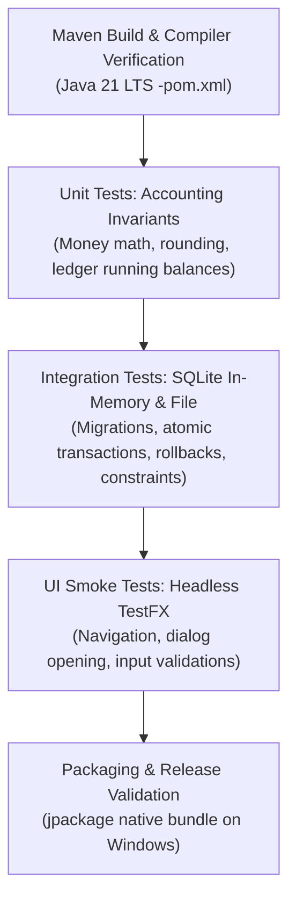

# SmartKhata — 18-Phase Implementation Plan & Traceability Matrix

This document defines the 18-phase engineering roadmap for SmartKhata. Each phase maps to a dedicated implementation stage, detailing specific SRS requirement coverage, technical tasks, verifiable acceptance criteria, accounting invariants, and risk mitigations.

---

## 1. Traceable 18-Phase Roadmap & SRS Mapping

| Phase | Module Name | Scope & Deliverable | Covered Requirements | Technical Acceptance Gate |
| :---: | :--- | :--- | :--- | :--- |
| **01** | **Project Architecture & SRS Mapping** | Architectural documentation, database DDL, screen inventory, accounting invariants. | FR-01 to FR-23, NFR-01 to NFR-07 | Complete architecture docs in `docs/`; zero application code written. |
| **02** | **JavaFX Foundation & Project Skeleton** | Maven configuration, Java 21 LTS, JavaFX 21, AtlantaFX theme, logging, bootstrap shell. | NFR-01, NFR-03, NFR-05 | App compiles via Maven and launches an empty styled desktop window; clean shutdown. |
| **03** | **SQLite Schema & Persistence Layer** | SQLite JDBC, WAL mode, foreign keys, schema migrations (`PRAGMA user_version`), DAO base. | FR-01, FR-03, NFR-02, NFR-04 | Automated migration test creates tables in `%LOCALAPPDATA%`; transactions commit/rollback cleanly. |
| **04** | **Desktop Dashboard UI (Design Reference)** | Pixel-close FXML/AtlantaFX layout matching `dashboard-reference.png`, sidebar router, KPI cards. | FR-19, NFR-05 | App boots into 1600x900 dashboard with working sidebar tabs, responsive cards, and clean styling. |
| **05** | **Local Identity & Business Setup** | First-run onboarding wizard, store profile setup, local PIN/password hashing, session lock. | FR-01, FR-02, FR-03, NFR-06 | First launch shows wizard; subsequent launch requires PIN/password; salt & hash stored safely. |
| **06** | **Customer Management & Due Ledger** | Customer CRUD, search, opening receivable balance, customer ledger statement view. | FR-04, FR-05, NFR-02 | Add customer with opening due BDT 500; customer ledger displays correct running balance. |
| **07** | **Supplier Management & Payable Ledger** | Supplier CRUD, search, opening payable balance, supplier ledger statement view. | FR-06, FR-07, NFR-02 | Add supplier with opening payable BDT 1,000; supplier ledger displays payable balance. |
| **08** | **Product Catalog & Stock Movements** | Products CRUD, categories, barcodes, units, pricing, auditable stock movements, reorder alert. | FR-08, FR-09, FR-10, NFR-02 | Opening stock movement posts; manual adjustment requires reason; stock cannot be arbitrarily overwritten. |
| **09** | **Sales POS & Credit Invoicing** | POS invoicing screen, barcode scanner hook, cash/credit settlement, atomic stock deduction. | FR-11, FR-12, NFR-02, NFR-05 | Sale of 2 items decreases stock by 2; credit sale updates customer due atomically; invoice generated. |
| **10** | **Purchases & Supplier Dues** | Supplier purchase bill entry, stock intake, payable update, atomic purchase transaction. | FR-13, FR-14, NFR-02 | Purchase increases stock and supplier payable atomically; duplicate bill retry rejected. |
| **11** | **Customer Collections & Supplier Payments** | Receive payment dialog, supplier disbursement, FIFO invoice allocation, advance balance safety. | FR-15, FR-16, NFR-02 | BDT 400 received against BDT 1,000 due results in exact BDT 600 remaining due; no double postings. |
| **12** | **Expense & Other Income Tracking** | Categorized expense entries, non-sales income tracking, cash drawer balance synchronization. | FR-17, FR-18, NFR-02 | Expenses recorded once; purchase costs and operational expenses are strictly segregated. |
| **13** | **Real Data Dashboard Integration** | Connect dashboard KPI cards, live revenue trend line chart, dues widget, low-stock alerts to SQLite. | FR-10, FR-19, NFR-03 | Hard-coded UI placeholders replaced by live SQLite aggregate queries; empty states honest. |
| **14** | **Reporting & Document Export** | Daily Daybook, Sales/Purchase summaries, Due list, Customer statements, PDF & CSV export. | FR-20, FR-21, NFR-03 | Daybook reconciles cash in/out; CSV exports cleanly escape commas; printable PDF generated. |
| **15** | **Settings, Localization & Preferences** | Business profile editor, Bangla / English bilingual resource bundle, BDT currency formatter. | FR-23, NFR-05 | UI language toggles between Bangla and English; numbers format as South Asian BDT 4,86,530. |
| **16** | **Reliable SQLite Backup & Recovery** | "Back Up Now" action, `VACUUM INTO`, integrity check, manifest generation, safe restore workflow. | FR-22, NFR-04 | Backup produces valid coherent `.skbak` file; restore creates safety copy and validates schema. |
| **17** | **Quality Assurance & Accounting Audit** | Automated accounting invariant tests, stress tests, rapid double-click tests, layout visual QA. | All FRs, All NFRs | Deterministic test dataset executes all core workflows without accounting discrepancy or crash. |
| **18** | **Windows Packaging & Release** | `jlink` / `jpackage` bundling with embedded Java 21 runtime, standalone `.msi`/`.exe`, user manual. | NFR-07 | Standalone Windows application installs and runs on clean Windows machine without external JRE. |

---

## 2. Key Risks & Technical Mitigations

| Risk Factor | Impact | Mitigation Strategy |
| :--- | :--- | :--- |
| **SQLite Database Locking (`SQLITE_BUSY`)** | Multiple background worker threads (e.g., dashboard query + user saving a sale) causing locked database exceptions. | Configure `PRAGMA busy_timeout = 5000;` on all connections. Use Write-Ahead Logging (`PRAGMA journal_mode = WAL;`) allowing concurrent readers while a writer commits. Enforce a single writer thread/executor for writes. |
| **UI Freeze on Heavy Report Queries** | Large ledger calculations blocking the JavaFX Application Thread, causing window unresponsiveness. | Execute all database queries on Java Virtual Threads (`Executors.newVirtualThreadPerTaskExecutor()`) or JavaFX `Task<T>`. Update UI elements exclusively via `Platform.runLater()`. |
| **Corrupted SQLite Backups during Active WAL** | Direct file copy of `smartkhata.db` copying only the main DB file while active transactions remain in `smartkhata.db-wal`. | Never perform standard file copies on live database files. Use SQLite native `VACUUM INTO 'path/to/backup.skbak'` or the SQLite Online Backup API, preceded by `PRAGMA wal_checkpoint(PASSIVE);`. |
| **Floating-Point Rounding Discrepancies** | Fractional paisha calculation errors accumulating into balance sheet imbalances. | Zero `double` / `float` usage in financial paths. Strict use of 64-bit integer Paisha (`long`) and `BigDecimal` with explicit scale 2 and `RoundingMode.HALF_UP`. |
| **Duplicate Transaction Posting from Double Clicks** | Impatient cashiers double-clicking "Confirm Sale" or "Receive Payment", generating double invoices. | Disable UI action buttons immediately on initial click. Enforce a client-generated UUID `idempotency_key` backed by a SQLite `UNIQUE` constraint on `sales` and `payments`. |
| **Windows DPI / Display Scaling Issues** | Text clipping or misaligned UI elements on 125% / 150% Windows scaling displays. | Utilize resolution-independent JavaFX layouts (`GridPane`, `HBox`, `VBox` with percentage widths, min/pref/max sizing constraints) and avoid fixed pixel bounds on text containers. |

---

## 3. Architectural Decisions for User Review

1. **Monetary Representation:**
   - *Proposal:* All database columns and domain arithmetic use **64-bit integer Paisha** (`long`, where BDT 100.50 = 10,050 Paisha), wrapped in an immutable `Money` value object.
   - *Benefit:* Maximum computational speed, zero floating-point drift, native SQLite integer compatibility.
   - *Decision:* Approved as technical baseline.

2. **Default Language on First Boot:**
   - *Proposal:* Default to English with immediate toggle to Bengali (বাংলা) in the top header and Settings, ensuring wide compatibility with standard Windows system fonts.
   - *Font Strategy:* Embed a high-quality open-source Bengali Unicode font (e.g., *Hind Siliguri* or *Kalpurush*) in `src/main/resources/fonts/` with CSS fallback to system fonts (`Segoe UI`, `Vrinda`).

3. **Customer Credit Limit Behavior:**
   - *Proposal:* When a credit sale causes a customer's balance to exceed their configured credit limit, display a prominent confirmation dialog allowing the Owner/Manager to approve with an override reason, rather than a hard crash. For Cashiers, credit limit breach is strictly blocked.

4. **Invoice Numbering Scheme:**
   - *Proposal:* Sequential format scoped to the current calendar year: `INV-YYYY-XXXXX` (e.g., `INV-2025-00001`). Sequence tracked atomically via a dedicated sequence counter table.

---

## 4. Build, Verification & Testing Strategy

### 4.1 Test Suites by Layer
1. **Unit Tests (JUnit 5 + AssertJ):**
   - Monetary engine: integer Paisha addition, subtraction, multiplication by quantity, discount rounding.
   - Model validations: mandatory customer names, positive sale prices, valid phone formats.
   - Idempotency token generation and verification.
2. **Persistence Integration Tests (SQLite):**
   - Execute all migration scripts from version 0 to current. Verify table schemas and foreign key enforcement.
   - Simulate transaction rollback: induce a failure on sale line item 3 of 5, verify that sale header, ledger, and stock movements are 100% rolled back.
   - Test `VACUUM INTO` backup and restore with `PRAGMA integrity_check`.
3. **Accounting Invariant Deterministic Suite (Stage 17 Gate):**
   - Deterministic test script: Credit sale BDT 1,000 $\rightarrow$ Due 1,000; Receive BDT 400 $\rightarrow$ Due 600; Supplier credit purchase BDT 750 with payment BDT 250 $\rightarrow$ Payable 500; Expense BDT 120 displayed exactly once.
4. **Desktop Packaging Verification (Stage 18 Gate):**
   - Verify `jpackage` output runs on a clean Windows machine without requiring Java, Python, or MySQL installed.

